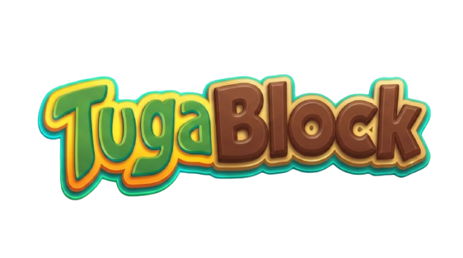
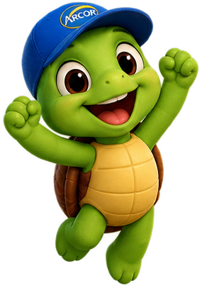
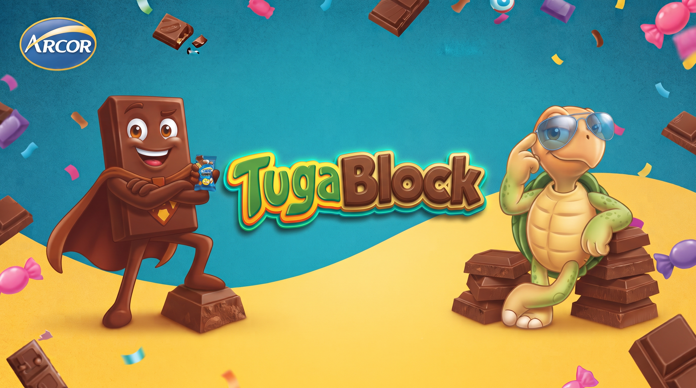

# FECAP - Fundação de Comércio Álvares Penteado

<p align="center">
<a href= "https://www.fecap.br/"></a>
</p>

# TugaBlock - Desafio das Marcas
<p align="center">
  
  
</p>

<p align="center">
  <strong>🐢 Você conhece realmente a Arcor, a Tortuguita e o Block?</strong><br>
  Teste seus conhecimentos, acumule pontos e desafie seus amigos!
</p>

# Grupo: MDGP

## Integrantes: <a href="https://www.linkedin.com/in/muriloeverissimo/">Murilo Verissimo Pereira</a>, <a href="https://www.linkedin.com/in/joaosouza22">João Pedro da Silva Souza</a>, <a href="https://www.linkedin.com/in/giseleribeirodossantos/">Gisele Ribeiro dos Santos</a>, <a href="https://www.linkedin.com/in/daniel-sobral-quio-477b073a7">Daniel Sobral Quio</a>

## Professores Orientadores: <a href="https://www.linkedin.com/in/victorbarq">Victor Bruno Alexander Rosetti de Quiroz</a>, <a href="https://www.linkedin.com/in/ronaldo-araujo-pinto-3542811a">Ronaldo Araujo Pinto</a>, <a href="https://www.linkedin.com/in/remuniz">Renata Muniz do Nascimento</a>, <a href="https://www.linkedin.com/in/mmamorim">Marcelo Amorim</a>, <a href="https://www.linkedin.com/in/aimarlopes">Aimar Martins Lopes</a>

## Descrição

<p align="center">

 Jogo desenvolvido por <a>Murilo Verissimo, João Souza, Gisele Ribeiro e Daniel Quio</a> - <a href="https://www.fecap.br/">FECAP (PI)</a> | Imagens por <a href="https://gemini.google.com/">Gemini AI</a> (Inspirado em Arcor, Tortuguita e Block)
</p>

Prepare-se para uma experiência que mistura **conhecimento, diversão e competição**! Responda perguntas sobre a Arcor, sua história e seus produtos — cada resposta é uma oportunidade de mostrar que você é fã de verdade!

## Sobre o Jogo
O **TugaBlock** é um quiz interativo desenvolvido como Projeto Integrador (PI) pelos alunos de Análise e Desenvolvimento de Sistemas da FECAP, com o objetivo de apresentar a marca **Arcor**, seus produtos Block, Tortuguita e outros, por meio da tecnologia e criatividade, proporcionando uma experiência divertida, dinâmica e envolvente. **Nossa proposta:** aproximar os consumidores da marca com perguntas e desafios sobre sua história e seus produtos, incentivando o conhecimento e o interesse de forma lúdica.

<br><br>

### Como jogar?

O jogo é dividido em três níveis de dificuldade: **Fácil**, **médio** e **difícil**. Perguntas de diferentes dificuldades oferecem pontuações diferentes. Ao final, os pontos acumulados pelos participantes serão utilizados para criar um ranking, estimulando a competição saudável e o engajamento.
- 🎚️ **Escolha seu desafio:** jogue nos níveis **Fácil**, **Médio** ou **Difícil**.
- ⭐ **Some pontos:** perguntas de diferentes dificuldades oferecem pontuações diferentes.
- 🏆 **Consulte o ranking:** acompanhe os resultados e dispute as melhores posições.

## 🛠 Estrutura de pastas

-Raiz<br>
<br>
|-->documentos<br>
  &emsp;|-->Entrega 1.docx<br>
&emsp;&emsp;|-->Algoritmos_e_Lógica_de_Programação<br>
&emsp;&emsp;|-->Banco de Dados<br>
&emsp;&emsp;|-->Matemática Discreta<br>
&emsp;&emsp;|-->Modelagem de Software e Arquitetura de Sistemas<br>
&emsp;&emsp;|-->Redes de Computadores<br>
  &emsp;|-->Entrega 2.docx<br>
&emsp;&emsp;|-->Algoritmos_e_Lógica_de_Programação<br>
&emsp;&emsp;|-->Banco de Dados<br>
&emsp;&emsp;|-->Matemática Discreta<br>
&emsp;&emsp;|-->Modelagem de Software e Arquitetura de Sistemas<br>
&emsp;&emsp;|-->Redes de Computadores<br>
  &emsp;|Documento - Projeto de Extensão - COM Empresa - 2026_1.docx<br>
|-->executáveis<br>
  &emsp;|-->windows<br>
  &emsp;|-->android<br>
  &emsp;|-->HTML<br>
|-->imagens<br>
  &emsp;|block.png<br>
  &emsp;|capa.png<br>
  &emsp;|fundo.png<br>
  &emsp;|logo-arcor.png<br>
  &emsp;|mascote.png<br>
  &emsp;|mascote-feliz.png<br>
  &emsp;|mascote-triste.png<br>
  &emsp;|tortuguita.png<br>
  &emsp;|trofeu.png<br>
|-->src<br>
  &emsp;|-->Backend<br>
  &emsp;|-->Frontend<br>
|README.md<br>

## 🛠 Instalação

**Windows:**

Não é necessário instalar dependências ou ferramentas de desenvolvimento. Basta executar o jogo.

1. Acesse a pasta `executáveis/windows`.
2. Localize o arquivo `TugaBlock.exe`.
3. Só executar o programa!🐢

> **Observação:** o executável deve estar acompanhado dos arquivos necessários para funcionamento, incluindo a API e o banco SQLite, conforme a configuração de distribuição do projeto.


## 💻 Configuração para Desenvolvimento

Para desenvolver e executar o Quiz TugaBlock no Windows, é necessário instalar:
🐢 .NET SDK: permite compilar, executar e testar aplicações C# e ASP.NET Core.
🐢 IDEs sugeridas: Visual Studio ou Visual Studio Code.
🐢 Git: utilizado para clonar o repositório e controlar versões.
🐢 SQLite: banco de dados utilizado pelo projeto. Não exige instalação de um servidor MySQL.
🐢 Extensão C# Dev Kit: recomendada para desenvolvimento C# no Visual Studio Code.

## 🔍Testes

Os testes automatizados podem ser executados utilizando o framework xUnit e o comando:

```sh
dotnet test
```
> O projeto de testes deve estar configurado no repositório.

## 📋 Licença/License
<a href="https://github.com/2026-2-NADS1/Projeto6">TugaBlock</a> © 2026 by <a href="https://github.com/2026-2-NADS1/Projeto6">João Pedro da Silva Souza, Gisele Ribeiro dos Santos, Murilo Verissimo Pereira, Daniel Sobral Quio, FECAP</a> is licensed under <a href="https://creativecommons.org/licenses/by/4.0/">Creative Commons Attribution 4.0 International</a>

## 🎓 Referências

Aqui estão as referências usadas no projeto.

1. <https://github.com/iuricode/readme-template>
2. <https://github.com/gabrieldejesus/readme-model>
3. <https://chooser-beta.creativecommons.org/>
4. <https://freesound.org/>
5. <https://www.toptal.com/developers/gitignore>
6. Músicas por: <a href="https://freesound.org/people/DaveJf/sounds/616544/"> DaveJf </a> e <a href="https://freesound.org/people/DRFX/sounds/338986/"> DRFX </a> ambas com Licença CC 0.
